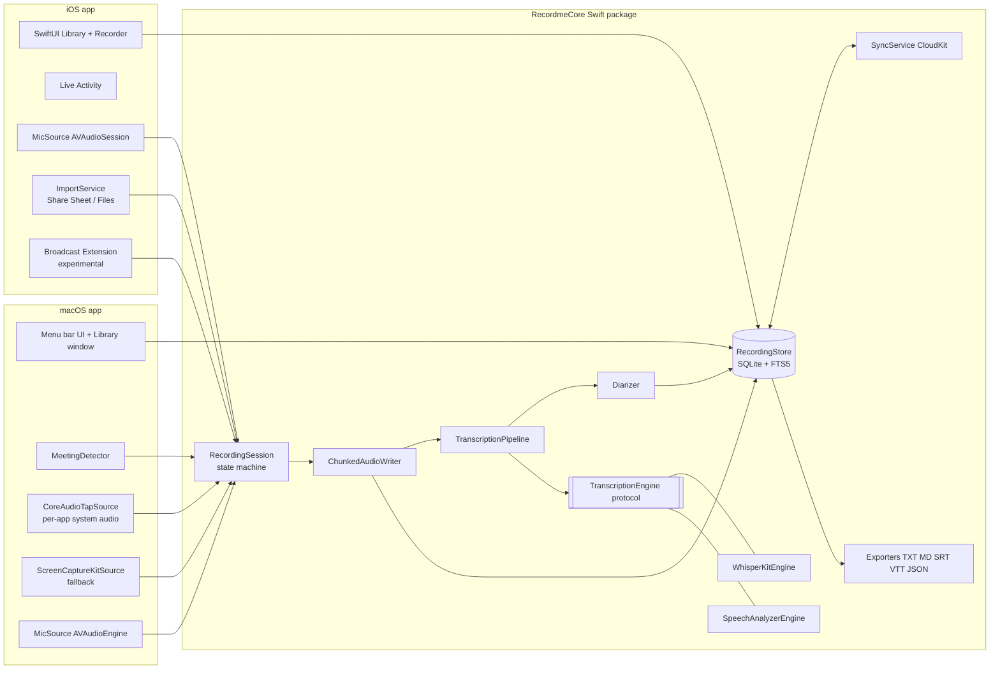
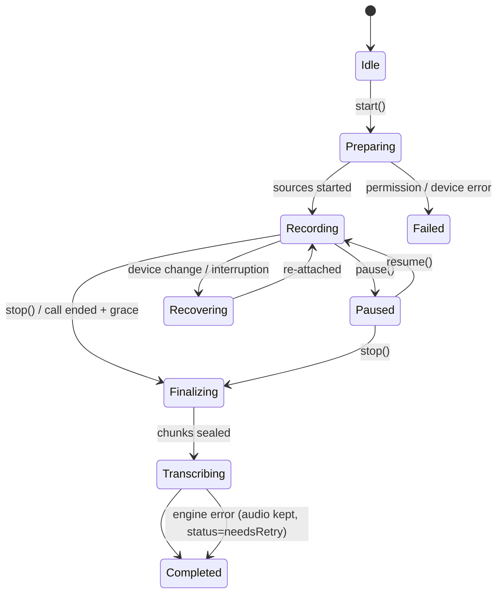
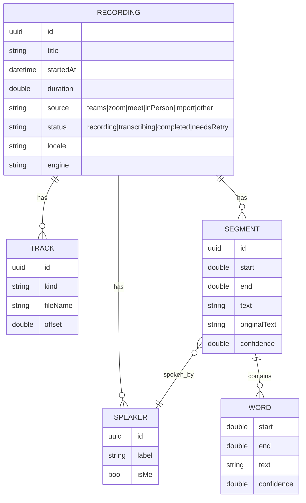

# Recordme Solution Design

Version 0.1 · Traces to `specs/01-requirements.md` v0.1

## 1. Architecture overview

Recordme is two native SwiftUI apps (macOS, iOS) on top of one shared Swift package, `RecordmeCore`. Platform-specific capture lives in thin adapters; everything after "PCM buffers exist" is shared.



### Key decisions (see ADRs)

| ADR | Decision |
| --- | --- |
| [0001](../docs/adr/0001-native-swift-multiplatform.md) | Native Swift + SwiftUI multiplatform, shared Swift package |
| [0002](../docs/adr/0002-macos-system-audio-capture.md) | Core Audio process taps for system audio, ScreenCaptureKit fallback |
| [0003](../docs/adr/0003-on-device-transcription-engine.md) | Pluggable engine: Apple SpeechAnalyzer default, WhisperKit fallback |
| [0004](../docs/adr/0004-ios-call-capture-strategy.md) | iOS call capture via import, speakerphone mic and Mac handoff; ReplayKit experimental |
| [0005](../docs/adr/0005-storage-and-sync.md) | Files on disk + SQLite (GRDB) with FTS5; CloudKit private DB for sync |

## 2. Module structure

```
RecordmeCore/            (Swift package, platform-neutral where possible)
  Model/                 Recording, Track, Segment, Word, Speaker, Source
  Session/               RecordingSession state machine, AudioSource protocol
  Audio/                 ChunkedAudioWriter, Resampler, LevelMeter, Mixer
  Transcription/         TranscriptionEngine protocol, Pipeline, Merger
  Diarization/           Diarizer protocol, track-based attribution
  Storage/               RecordingStore (GRDB), FTS5 search, file layout
  Export/                TXT, Markdown, SRT, WebVTT, JSON exporters
  Sync/                  CloudKit sync (later)
Apps/macOS/              Menu bar app, Library window, Settings, MeetingDetector,
                         CoreAudioTapSource, ScreenCaptureKitSource
Apps/iOS/                Library, Recorder, Live Activity, ImportService
Apps/iOSBroadcast/       ReplayKit broadcast upload extension (experimental)
```

## 3. Capture design

### 3.1 AudioSource abstraction

```swift
protocol AudioSource: AnyObject {
    var kind: TrackKind { get }                 // .microphone, .system
    var format: AVAudioFormat { get }
    func start(_ onBuffer: @escaping (AVAudioPCMBuffer, AVAudioTime) -> Void) throws
    func stop()
}
```

All sources deliver PCM which is resampled to **16 kHz mono Float32** for the engines and, in parallel, encoded at 48 kHz AAC for playback/export.

### 3.2 macOS system audio (REQ-CAP-001, 002)

1. Resolve target processes: bundle IDs `com.microsoft.teams2`, `com.microsoft.teams`, `us.zoom.xos`, and browsers (`com.google.Chrome`, `com.apple.Safari`, `company.thebrowser.Browser`, `com.microsoft.edgemac`, `org.mozilla.firefox`) for Meet. Map to `AudioObjectID` via `kAudioHardwarePropertyTranslatePIDToProcessObject`.
2. Create `CATapDescription(stereoMixdownOfProcesses:)`, mute behaviour `.unmuted`, private tap.
3. `AudioHardwareCreateProcessTap` then build a private aggregate device containing the tap, attach an IOProc, and forward buffers.
4. If tap creation fails (OS < 14.4, permission denied), fall back to `SCStream` with `capturesAudio = true`, `excludesCurrentProcessAudio = true`, and a minimal 2x2 video config that is discarded.
5. Mode "All system audio" taps all processes except Recordme.

### 3.3 Microphone

* macOS: `AVAudioEngine.inputNode` with voice processing **off** (we want the raw mic; the meeting app already does echo cancellation on its own path). Track tagged `.microphone`.
* Echo bleed: if the user is on speakers, remote audio leaks into the mic. The pipeline applies a lightweight **cross-track gate**: mic segments whose energy correlates strongly with simultaneous system-track energy are suppressed for attribution. Recommend headphones in UI.
* iOS: `AVAudioSession` category `.playAndRecord`, mode `.default` (`.measurement` for in-room), options `allowBluetooth`, `defaultToSpeaker`; background mode `audio`.

### 3.4 RecordingSession state machine



### 3.5 Crash-safe writing (REQ-CAP-003, NFR-04)

* Each track writes rolling **10 s CAF chunks** (`track-mic/000123.caf`) via `AVAudioFile`, fsync on rotation.
* A `session.json` manifest is updated on every rotation (atomic write via temp file + rename).
* On launch, `RecoveryService` scans for manifests with state `recording`, seals them, and enqueues transcription.
* On finalize, chunks are concatenated and transcoded to `mic.m4a` / `system.m4a`; chunks are deleted only after the transcode is verified.

### 3.6 Meeting detection on macOS (REQ-CAP-007, 008)

Signals combined in `MeetingDetector`:

| Signal | API |
| --- | --- |
| Mic in use by another process | `kAudioDevicePropertyDeviceIsRunningSomewhere` + `kAudioHardwarePropertyProcessObjectList` / `kAudioProcessPropertyIsRunningInput` (14.4+) |
| Meeting app running and producing audio | `NSWorkspace.runningApplications`, `kAudioProcessPropertyIsRunningOutput` |
| Meet in browser | Browser process using mic + window title contains "Meet" (Accessibility permission, optional) |
| Calendar context | EventKit event in progress with a Teams/Zoom/Meet URL (optional) |

Rule: *meeting app (or browser) is using the mic for more than 3 s* then show notification "Teams call detected: Record?". End: *mic released by that process for longer than the grace period*.

## 4. Transcription design

### 4.1 Engine protocol

```swift
protocol TranscriptionEngine {
    var id: EngineID { get }
    func supports(locale: Locale) async -> Bool
    func prepare(locale: Locale) async throws            // model download / asset install
    func transcribe(file: URL, options: TranscriptionOptions) -> AsyncThrowingStream<Segment, Error>
    func live(options: TranscriptionOptions) -> LiveTranscriptionSession
}
```

| Engine | Platforms | Use |
| --- | --- | --- |
| `SpeechAnalyzerEngine` (Apple `SpeechAnalyzer` + `SpeechTranscriber`) | macOS 26+, iOS 26+ | Default. Fully on-device, long-form, low battery, word timings. |
| `WhisperKitEngine` (CoreML Whisper large-v3-turbo / small) | macOS 14+, iOS 17+ | Fallback for older OS, additional languages, user preference for accuracy. |

### 4.2 Pipeline (REQ-TRN-001..010)

1. For each track: VAD (energy + engine VAD) splits audio into utterances.
2. Each track is transcribed independently. Track identity gives speaker: mic is **Me**, system is **Remote**.
3. Optional diarisation on the system track (and on single-track in-room recordings) using an on-device speaker-embedding model (CoreML, for example a pyannote-derived segmentation + embedding model) and agglomerative clustering. Produces **Speaker 1..N**.
4. `TranscriptMerger` interleaves segments from both tracks by start time; overlapping speech is kept as separate segments.
5. Output is stored as-is. **No text post-processing beyond the engine's own punctuation** (Constitution 1).
6. Live mode: engines stream volatile results to the UI; final pass after stop replaces them (REQ-TRN-007).

### 4.3 Job scheduling

* `TranscriptionQueue` (actor) persists jobs in SQLite so they survive restarts.
* iOS: long jobs run in `BGProcessingTask` while charging, or foreground with progress. If sync is on and the user chose "Transcribe on Mac", job is marked `deferredToMac` (REQ-SYN-002).

## 5. Data model



### File layout

```
~/Library/Application Support/Recordme/          (macOS; iOS: app container)
  recordings/<uuid>/
    session.json        manifest (state, tracks, chunk index)
    mic.m4a             final audio per track
    system.m4a
    transcript.json     canonical transcript (also in SQLite)
    chunks/             transient, removed after finalize
  recordme.sqlite       GRDB database with FTS5 table segments_fts
```

## 6. Export (REQ-EXP-001)

| Format | Shape |
| --- | --- |
| TXT | `[00:01:23] Me: text` per line |
| Markdown | Title, metadata table, then `**Me** (00:01:23): text` |
| SRT | Standard numbered cues `00:01:23,400 --> 00:01:27,900`, speaker prefix |
| WebVTT | `WEBVTT` header, `<v Me>` voice tags |
| JSON | Full `Recording` with segments, words, speakers (schema versioned) |

Implemented in `Sources/RecordmeCore/Export` and unit tested.

## 7. Sync (REQ-SYN-001..003)

* CloudKit **private database**, custom zone `Recordings`. Record types `Recording`, `Segment` (batched per 200), `Speaker`. Audio as `CKAsset` (m4a).
* Conflict policy: last-writer-wins per field; speaker renames and text edits carry `modifiedAt`.
* Advanced Data Protection on the user's account gives end-to-end encryption; in addition audio assets can be encrypted with a per-library key stored in iCloud Keychain.
* Optional S3-compatible backup (Could): client-side AES-GCM encrypted upload to a user-owned bucket, for example AWS S3 with SSE-KMS and lifecycle rules to Glacier for long-term archiving. Aligns with a secure, well-architected AWS landing zone for teams that want centralised retention.

## 8. iOS specifics (ADR 0004)

| Mode | How | Quality |
| --- | --- | --- |
| In-person | Mic, `.measurement` mode, background audio, Live Activity | High |
| Call on speakerphone | Mic picks up both sides | Medium |
| Native call recording import | iOS 18.1+ Phone app records call, user shares audio to Recordme | High (cellular/FaceTime) |
| Mac handoff | Join on Mac, Mac records; transcript syncs to iPhone | High (Teams/Zoom/Meet) |
| Broadcast extension (experimental) | ReplayKit `audioApp` + `audioMic` buffers written to App Group container | Varies by app; often silent for VoIP |

Live Activity shows elapsed time, level meter and a stop button (App Intent). Interruptions (`AVAudioSession.interruptionNotification`) pause and auto-resume, inserting a `gap` marker in the transcript.

## 9. UI design

### macOS
* **Menu bar extra**: status dot, Record/Stop, source picker (All audio / Teams / Zoom / Browser), live level meters for both tracks, recent recordings.
* **Library window** (`NavigationSplitView`): sidebar (All, Calls, In-person, Imports), list, detail with player scrubber and transcript. Click a segment to seek; current segment highlighted; search with highlighting; speaker rename popover; Export menu.
* **Settings**: engine and model, language, auto-detect per app, auto-stop grace, storage location, retention, sync, consent message template, shortcuts.

### iOS
* Tabs: **Record** (big button, mode picker, levels, live transcript toggle), **Library**, **Settings**.
* Share extension target for importing audio.

## 10. Security and privacy

| Concern | Control |
| --- | --- |
| Data at rest | `NSFileProtectionCompleteUntilFirstUserAuthentication` on iOS, FileVault on macOS, optional app lock (LocalAuthentication) |
| Data in transit | None by default. CloudKit TLS + optional asset encryption. S3 via TLS + client-side encryption |
| Permissions | Mic, Audio Capture / Screen Recording, Speech (SpeechAnalyzer assets), Calendar (optional), Accessibility (optional), Notifications |
| Telemetry | None by default. Optional on-device `OSLog` export for bug reports |
| Consent | First-run legal notice, consent message copy, visible indicators, no hidden/covert mode |
| Supply chain | Swift Package Manager pinned versions, model files checksummed (SHA-256) |

## 11. Error handling

* Permission denied: deep link to the right System Settings pane with instructions.
* Tap source loss (meeting app quits and relaunches): `MeetingDetector` re-resolves the PID and re-attaches; segment gap recorded.
* Disk low (< 500 MB): warn; at < 100 MB stop gracefully and finalize.
* Engine failure: recording marked `needsRetry`, audio preserved, one-tap retry or switch engine.

## 12. Testing strategy

| Layer | Approach |
| --- | --- |
| Unit (RecordmeCore) | Exporters, merger, state machine, manifest recovery, time formatting. Runs on Linux CI and macOS. |
| Integration | Engine adapters against fixture WAVs with known transcripts; WER computed in CI on macOS runners. |
| Capture | Manual + scripted: play reference audio through a Zoom/Teams test call, verify both tracks. |
| Reliability | `kill -9` during recording 100 times; verify recovery (NFR-04). |
| Performance | Instruments templates for CPU/energy, tracked per release (NFR-01, 02, 06). |
| UI | XCUITest smoke flows on both platforms. |

## 13. Delivery pipeline

* GitHub Actions: `swift test` on Linux for core, `xcodebuild test` on macOS runners for apps.
* Fastlane: notarised DMG for macOS (Sparkle for updates), TestFlight for iOS.
* Semantic versioning; release notes reference requirement IDs.

## 14. Risks

| Risk | Likelihood | Impact | Response |
| --- | --- | --- | --- |
| iOS cannot capture VoIP audio | Certain | High | Documented alternatives (ADR 0004); set expectation in UI |
| Apple changes tap / ScreenCaptureKit permission UX | Medium | Medium | Dual capture path, clear onboarding |
| Echo bleed causes duplicate text on Me track | Medium | Medium | Cross-track gate, headphone recommendation |
| Diarisation accuracy on calls with many speakers | High | Low | Optional feature, easy speaker rename/merge |
| Model size on iPhone (WhisperKit) | Medium | Medium | Default to SpeechAnalyzer; small/turbo models; on-demand download |
| Legal misuse | Low | High | Consent features, no covert mode, ToS |
